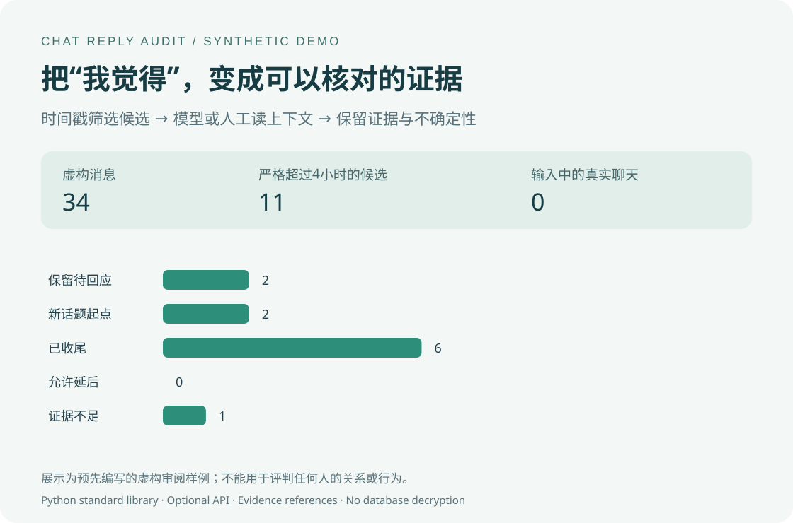

# Chat Reply Audit

把“我觉得你回得慢”，变成可以核对的记录。

面向双人聊天的回复间隔分析与上下文审阅工具，也是一份可复用的 Codex Skill。适用于符合输入规范、已获准处理的双人聊天文件，不限定聊天平台。

**时间戳筛候选 → 大模型或人工读上下文 → 引用证据 → 输出复核报告。**

> [!WARNING]
> **第三方数据提取／解密属于高风险操作。** 本项目仅分析已经合法取得、且有权处理的可读文件，不提供第三方工具推荐、下载链接、安装命令、密钥提取或解密步骤。数据来源与授权不清楚时，不应继续处理；可先使用虚构演示。风险与敏感副本处置见[数据获取风险说明](docs/HIGH_RISK_EXPORT.md)，不构成对获取方式的推荐或安全保证。



> 图中所有消息、日期、人物标签和审阅结果均为虚构样例。审阅答案预先编写，没有调用真实API，不代表模型准确率。

## 从这里开始：完整指引

| 你现在要做什么 | 按顺序读 |
|---|---|
| 还没有聊天导出文件 | [数据来源、官方备份边界、格式与手工小样本](docs/DATA_PREPARATION.md) |
| 已有 CSV，想从头照做 | [完整操作：输入 → 分阶段统计 → 候选 → 复核 → 报告](docs/WALKTHROUGH.md) |
| 想知道“上下文复核”到底怎么操作 | [人工离线表单](docs/WALKTHROUGH.md#4a-人工本机离线复核)、[Codex](docs/WALKTHROUGH.md#4b-交给在线-codex-复核)、[在线 API](docs/WALKTHROUGH.md#4c-在线-api-复核)、[本地模型](docs/WALKTHROUGH.md#4d-本地模型复核) 四条路线任选其一 |
| 已跑完、看不懂或报错 | [结果含义、计数口径和排错](docs/RESULTS_AND_TROUBLESHOOTING.md) |
| 在意数据会交给谁 | [全过程数据流](docs/DATA_PREPARATION.md#6-这条链路具体暴露了什么)与[隐私边界](docs/PRIVACY.md) |

对已有可读文件的格式转换、统计可以由本机程序完成，不必先让在线模型通读聊天。上下文判断需要读取相关正文：可自己在本机读，也可交给本地模型或明确授权的在线服务。**本地文件 ≠ 本地模型；A/B 标签 ≠ 自动匿名化。**

## 为什么要分两步

时间差很好算，“这段时间是否真的在等答复”需要结合对话。前一句可能是已经回答完的问题、晚安或确认语；隔天又开启新话题，单纯按发送方交替会把两段连在一起。

本项目保留原始间隔，同时允许模型或人工修正待回应起点。**候选不等于真实等待，真实延后回应也不等于不合理或故意不回。**

## 已包含的功能

- 已导出双人聊天的CSV/JSON输入；支持文档规定的中文列名映射，不限定来源软件。
- 首条/末条两种口径，全部平均、中位数、90分位、短间隔平均。
- 默认严格超过2、3、4小时的次数和比例，可修改阈值。
- 多阶段对比，跨阶段事件单列，末尾未完成等待单列。
- 按候选提取原文上下文，生成可填写的审阅模板。
- 可按候选编号只提取选定事件；提供不联网的本机浏览器复核表单，不必手写 JSON。
- 可选的兼容Chat Completions格式API审阅；密钥从环境变量读取。
- 对模型引用、事件编号、校准起点、阈值和完整性作确定性校验。
- HTML、Markdown、JSON和CSV报告。基础统计报告不输出正文，复核报告会包含相关摘录。

本项目的程序不读取聊天软件进程、不提取密钥、不解密数据库、不登录聊天账号、不发送消息。文档仅说明数据来源与风险，不推荐或讲解第三方提取、解密工具。不提供图片识别、语音转写或已读检测，不自动判定感情投入。

## 环境

### 依赖与外部服务

本项目自身的 Python 程序仅使用标准库，没有第三方 Python 运行时依赖；不包含、不调用，也不自动安装任何第三方聊天数据提取或解密工具。离线复核表单使用浏览器原生功能，无需安装第三方前端库。

本项目不分发、推荐或集成第三方聊天数据提取、解密工具，当前文档不提供相关下载、安装或操作步骤。**使用本项目无需执行 `pip install`。** 数据来源、输入格式及适用范围见[输入准备](docs/DATA_PREPARATION.md)。

可选的模型复核通过 Chat Completions 兼容接口，请求使用者自行选择的在线服务或本地模型服务。本项目不绑定任何服务商或模型；文档中的具体配置仅为示例。在线复核会发送选定的聊天片段，需事先确认服务与内容范围。

持续集成（CI）使用 GitHub Actions，运行代码测试、虚构演示复现和发布文件检查；不使用真实聊天，不调用付费模型服务，也不是本地运行本项目所需的依赖。

### 运行要求

Python **3.10或以上**，仅使用标准库。支持Windows、macOS、Linux；无需pip安装依赖。API审阅需要你自行选择服务、模型和有效凭据；不同提供方对JSON模式、token参数的支持需自行核实。

以下命令均在项目根目录执行，`python`在部分环境中需要改为`python3`。

## 一分钟看演示

不用配置API，可以直接打开：

- [虚构数据的基础统计](examples/demo-report/report.html)
- [虚构数据的逐条审阅样例](examples/demo-review/report.html)
- [用于演示的34条虚构消息](examples/demo.csv)

下载到本地后，用浏览器打开HTML。GitHub上的HTML链接通常显示源文件，不等于已经部署网页。

也可以重新运行：

```powershell
python scripts/reply_audit.py analyze --input examples/demo.csv --phases examples/phases.json --as-of 2030-01-07T18:00:00+08:00 --out private-output/my-demo
```

输出目录须为空或不存在。项目从不覆盖已有报告。

## 用自己的数据：完整流程

### 1. 准备已导出的双人会话

没有文件时，先读[数据来源与输入准备](docs/DATA_PREPARATION.md)，可选择虚构演示或经同意的手工小样本；本项目不提供从聊天账号批量获取记录的操作步骤。不要把数据库交给 Codex。官方备份不等于可读导出，已有 JSON 也不一定兼容本项目。建议把真实输入与输出放在仓库外的专用目录；下文的 private-input/private-output 是仓库内演示路径，不是加密区。

把你有权处理的单个双人会话放到`private-input/`，或者放在项目之外。不要把数据库、账号资料或密钥放进仓库。

最小CSV：

```csv
timestamp,sender,kind,message_id,conversation_id,text
2030-02-01 08:00:00,A,text,example-1,synthetic-example,演示资料准备好了吗？
2030-02-01 08:10:00,B,text,example-2,synthetic-example,准备好了。
```

没有正文也可以做基础统计。输入格式、中文字段、发送方映射、时区及限制见[输入格式](references/input-format.md)。

### 2. 先做不含正文的本地统计

```powershell
python scripts/reply_audit.py analyze --input private-input/chat.csv --timezone +08:00 --out private-output/run
```

可选参数：

```powershell
python scripts/reply_audit.py analyze --input private-input/chat.csv --phases examples/phases.json --short-minutes 120 --thresholds 120 180 240 --candidate-minutes 240 --out private-output/phased-run
```

使用自己的阶段文件替换演示阶段。`start`包含在内，`end`不包含在内；一条完整等待的首条发出和下一方发言必须都落在同一阶段。跨界单列，不重复计算。未指定`--as-of`时，固定观察截止为输入的末条有效消息，不会跟随当前时间增长。

主要输出：`report.html`、`report.md`、`analysis.json`、`summary.csv`、`events.csv`、`candidates.csv`、`boundary_events.csv`、`pending.csv`。

### 3. 按候选准备上下文

这一步**会导出正文片段**，所以需要显式加`--include-content`：

```powershell
python scripts/reply_audit.py prepare-review --input private-input/chat.csv --analysis private-output/run/analysis.json --include-content --out private-output/context
```

得到`context_packet.json`及`reviews_template.json`。默认每个候选包含前8条、整段连续消息、后10条；单条超过1200字符会标注截断。可用`--before`、`--after`、`--max-message-chars`调整，不能假装截断或未知媒体已经读完。

仅提取某几项时加 `--events` 和本次 candidates.csv 中的编号；后续复核只代表所选子集。完整命令与扩大上下文的办法见[完整流程第 3 节](docs/WALKTHROUGH.md#3-提取候选上下文)。

输入文件指纹与发送方映射须和统计时一致。如统计用了`--sender-a`，此处也要保持相同。

### 4A. 用Skill或人工审阅

可以按[审阅指南](references/review-guide.md)在本机编辑模板，也可以使用下面的表单。

不熟悉 JSON，可先生成离线表单：

```powershell
python scripts/reply_audit.py review-workbench --packet private-output/context/context_packet.json --out private-output/review-desk
```

在本机浏览器打开 `review-desk/index.html`，逐条读前后文、选择分类和校准起点、勾选证据、填写理由，然后下载 reviews.json。页面不联网、不自动保存；下载可能进入系统下载目录，需要自行移回私密位置。表单本身含正文，不要分享。具体填写办法见[人工复核步骤](docs/WALKTHROUGH.md#4a-人工本机离线复核)。

把下载的结果移到 `private-output/reviews.json`，再运行：

```powershell
python scripts/reply_audit.py apply-review --packet private-output/context/context_packet.json --reviews private-output/reviews.json --out private-output/reviewed
```

`retained`、`restart`必须用真实消息ref指定起点；确定性分类需要原文ref。默认要求全部候选都有审阅结果。使用`--allow-partial`才能导出不完整审阅，未审阅项会继续单列。

### 4B. 可选：调用大模型API审阅

先了解[数据发送与隐私边界](docs/PRIVACY.md)。这些API调用会发送选定候选的正文片段，可能产生费用。**基础统计不联网；在线模型的语义审阅不属于“全程本地”。**

在当前PowerShell会话配置你自己选择的服务。下面地址和模型名只是保留域名的配置示例，不能直接调用：

```powershell
$env:CHAT_REVIEW_API_URL = "https://api.example.com/v1/chat/completions"
$env:CHAT_REVIEW_MODEL = "provider-model-name"
```

密钥应通过你自己的环境变量或凭据管理方式设置为`CHAT_REVIEW_API_KEY`。不要把真实密钥写进脚本、聊天输入、截图、Git或命令参数；本项目不会自动读取`.env`。

先预览范围，不调用API：

```powershell
python scripts/reply_audit.py review-api --packet private-output/context/context_packet.json --max-cases 3 --dry-run
```

确认服务及片段范围后，再显式发送：

```powershell
python scripts/reply_audit.py review-api --packet private-output/context/context_packet.json --max-cases 3 --send-content --out private-output/model-reviews.json
```

默认每个候选一次请求、60秒超时；可配置`--attempts`（1至3）、`--max-case-chars`和`--max-output-tokens`。字符预览不是token数或价格估算。`--max-cases`用于小范围试跑，其他事件仍标记未审阅；当前版本不自动断点续跑，重复运行会重新请求所选候选。

端点必须是完整的兼容Chat Completions请求地址。默认发送`response_format: {"type":"json_object"}`及`max_tokens`；提供方不支持JSON模式时可加`--no-json-mode`。本地模型的回环HTTP端点需额外加`--allow-local-endpoint`，不能用于远程明文HTTP。API重定向会被拒绝，不把对话或认证信息转发到新地址。

再将模型建议生成报告：

```powershell
python scripts/reply_audit.py apply-review --packet private-output/context/context_packet.json --reviews private-output/model-reviews.json --allow-partial --out private-output/model-report
```

模型输出错误、引用不存在、起点与阈值冲突或预算超限，会保留为待核。校验只能证明结构和引用有效，**不能证明推理正确**。报告明确显示“模型建议，尚未人工确认”。

密钥的本机隐藏输入方式、试跑后扩大范围、恢复填写和本地模型设置见[完整复核流程](docs/WALKTHROUGH.md)。先预览数量，再在离线表单检查拟发送正文；dry-run 不显示正文，也不连接服务检验配置。

## 安装为Codex Skill

将整个项目文件夹复制到你本机的Codex skills目录，文件夹名保持`chat-reply-audit`，并确保根目录有`SKILL.md`。按你的Codex环境刷新或重新载入后，可用：

```text
使用 $chat-reply-audit 分析我指定的双人聊天导出文件，先做元数据统计。
```

需要上下文审阅时再明确提出。Skill不会因为存在API配置就自动发送私聊。这里提供的是Codex Skill入口与元数据；其他Agent是否识别同样格式，请按各自文档核实，未声称全面兼容。

## 开发与核对

```powershell
python -B -m unittest discover -s tests -v
python -B scripts/build_demo.py --check
python -B scripts/privacy_check.py
```

测试仅使用虚构数据，API测试为内存桩，不调用任何在线服务。`build_demo.py`只重建固定的虚构样例；其结果不是模型评测成绩。

发布前阅读[发布审查说明](docs/PUBLISHING.md)。公开文件有精确白名单与摘要；运行产物不应提交。`.gitignore`和扫描不能替代人工审查，也不能清除已经进入Git历史的数据。

## 项目结构

```text
SKILL.md / agents/      Codex入口与调用信息
scripts/               统计、上下文准备、API适配、报告和发布检查
references/            输入格式与逐条审阅准则
examples/              完全虚构的输入、阶段和演示产物
assets/                从虚构数据生成的展示图
tests/                 确定性逻辑及模拟API测试
docs/                  隐私与发布边界
```

代码以 MIT 许可提供，见[LICENSE](LICENSE)。本项目独立于任何聊天平台，不隶属于任何平台运营方，也不代表获得其授权或背书。项目不鼓励绕过访问限制或技术保护；使用者应遵守适用法律、平台规则和参与者授权范围。
